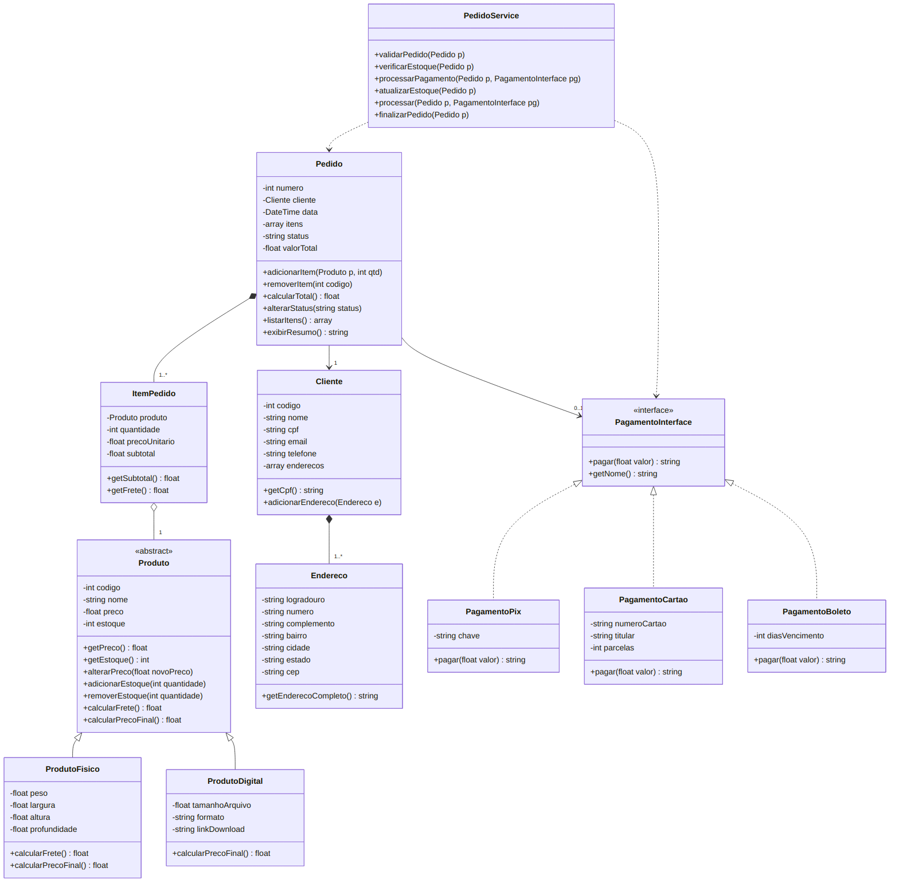

# Loja POO

Sistema de loja virtual feito em PHP puro usando Programação Orientada a Objetos.

## Objetivo

Simular uma compra completa em uma loja virtual (cadastro de produtos, cliente, pedido, pagamento e baixa de estoque) aplicando os conceitos de POO vistos em aula.

## Descrição

O sistema trabalha com produtos físicos e digitais, clientes com endereço, pedidos com vários itens e três formas de pagamento (PIX, cartão e boleto). Todas as regras de processamento do pedido ficam na classe `PedidoService`, e o `index.php` só monta o cenário de teste e mostra o resultado.

## Estrutura das pastas

```
loja-poo/
├── src/
│   ├── Models/
│   │   ├── Produto.php
│   │   ├── ProdutoFisico.php
│   │   ├── ProdutoDigital.php
│   │   ├── Cliente.php
│   │   ├── Endereco.php
│   │   ├── Pedido.php
│   │   └── ItemPedido.php
│   ├── Interfaces/
│   │   └── PagamentoInterface.php
│   ├── Pagamentos/
│   │   ├── PagamentoPix.php
│   │   ├── PagamentoCartao.php
│   │   └── PagamentoBoleto.php
│   ├── Services/
│   │   └── PedidoService.php
│   └── Exceptions/
│       ├── EstoqueInsuficienteException.php
│       ├── PedidoInvalidoException.php
│       └── PagamentoException.php
├── index.php
├── docs/
│   ├── diagrama-classes.png
│   └── saida-execucao.txt
├── diagrama-classes.mermaid
└── README.md
```

## Classes implementadas

| Classe | Namespace | Função |
|---|---|---|
| Produto | App\Models | Classe abstrata com os dados comuns de todo produto |
| ProdutoFisico | App\Models | Produto com peso e medidas, cobra frete |
| ProdutoDigital | App\Models | Produto com formato, tamanho e link, sem frete |
| Cliente | App\Models | Dados do cliente e lista de endereços |
| Endereco | App\Models | Endereço do cliente |
| ItemPedido | App\Models | Produto + quantidade, calcula o subtotal |
| Pedido | App\Models | Itens, status, total e resumo do pedido |
| PagamentoInterface | App\Interfaces | Contrato das formas de pagamento |
| PagamentoPix / PagamentoCartao / PagamentoBoleto | App\Pagamentos | Formas de pagamento |
| PedidoService | App\Services | Validação, estoque, pagamento e finalização |
| EstoqueInsuficienteException, PedidoInvalidoException, PagamentoException | App\Exceptions | Exceções personalizadas |

## Conceitos de POO utilizados

**Encapsulamento:** todos os atributos são `private`. Os dados são lidos por getters e alterados só por métodos que validam o valor, como `alterarPreco()`, `adicionarEstoque()` e `removerEstoque()`. O CPF do cliente não tem setter, então não muda depois que o objeto é criado. O subtotal do `ItemPedido` é calculado dentro da classe e não existe forma de informar ele manualmente. O status do pedido só muda pelo `alterarStatus()`, que só aceita mudanças permitidas (ex.: não dá para ir de Aberto direto para Concluído).

**Herança:** `ProdutoFisico` e `ProdutoDigital` herdam de `Produto`. As exceções personalizadas herdam de `Exception`.

**Abstração:** `Produto` é abstrata, então não dá para criar um "produto genérico". Ela concentra o que todo produto tem (código, nome, preço, estoque e o controle desses dados) e obriga as filhas a implementar `calcularPrecoFinal()`.

**Polimorfismo:** `calcularPrecoFinal()` funciona diferente em cada produto (o físico soma o frete, o digital retorna só o preço) e o `Pedido` chama o mesmo método sem saber o tipo. No pagamento, o `PedidoService::processar()` recebe um `PagamentoInterface` e chama `pagar()`, e cada classe faz o pagamento do seu jeito.

**Composição:**
- Cliente → Endereco: o cliente já é criado com um endereço obrigatório e guarda a lista de endereços.
- Pedido → ItemPedido: o próprio pedido cria os itens dentro de `adicionarItem()`; o item não existe fora do pedido.
- ItemPedido → Produto: cada item guarda a referência do produto vendido e o preço unitário no momento da compra.

**Interface:** `PagamentoInterface` define que toda forma de pagamento precisa ter `pagar()` e `getNome()`. Assim o service e o pedido dependem só da interface, e dá para criar uma forma nova de pagamento sem mexer neles.

**Namespaces e autoload:** as classes estão nos namespaces `App\Models`, `App\Services`, `App\Pagamentos`, `App\Interfaces` e `App\Exceptions`. O carregamento é feito com `spl_autoload_register()` no `index.php`, convertendo o namespace `App\` para a pasta `src/`.

## Regras de negócio

1. Produto não pode ter preço negativo (verificado no construtor e no `alterarPreco()`).
2. Estoque não pode ficar negativo (`removerEstoque()` lança `EstoqueInsuficienteException`).
3. Item precisa ter quantidade maior que zero.
4. Pedido precisa ter pelo menos um item para ser processado.
5. Pedido cancelado não pode ser pago.
6. Pedido concluído não recebe novos itens.
7. O pedido só é concluído depois de pago.
8. O estoque só é baixado depois da confirmação do pagamento.
9. Não é possível vender mais do que o estoque disponível.
10. Produto digital não tem frete.

**Regra do frete:** R$ 10,00 fixo + R$ 5,00 por kg, por unidade do produto físico. Para o teclado (1,2 kg): 10 + 6 = R$ 16,00 por unidade.

## Como executar

Precisa do PHP 7.4 ou superior instalado.

```
cd loja-poo
php index.php
```

Para salvar a saída em arquivo:

```
php index.php > saida.txt
```

## Testes realizados

| Teste | Situação | Resultado esperado |
|---|---|---|
| 1 | Comprar 50 teclados com 8 em estoque | `EstoqueInsuficienteException` |
| 2 | Adicionar quantidade 0 | `PedidoInvalidoException` |
| 3 | Criar produto com preço -80 | `InvalidArgumentException` |
| 4 | Processar pedido sem itens | `PedidoInvalidoException` |
| 5 | Adicionar item em pedido concluído | `PedidoInvalidoException` |
| 6 | Pagar pedido cancelado | `PagamentoException` |

Em todos os casos a exceção é capturada e o sistema mostra a mensagem sem parar a execução. A saída completa está em `docs/saida-execucao.txt`.

## Diagrama de classes



O código fonte do diagrama está em `diagrama-classes.mermaid`.
"# loja.poo" 
